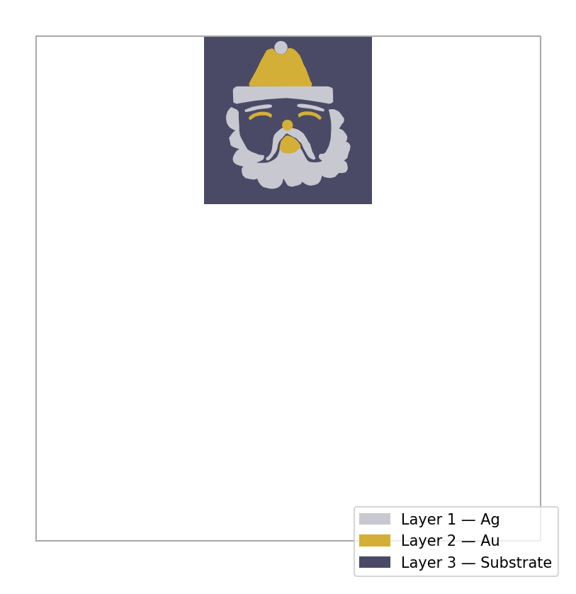

# Art on a Chip — Santa Pattern Chip Layout (GDS)

> KLayout GDS layout of a Santa-face electrode pattern, fabricated on-chip by shadow-mask thermal evaporation (Ag/Au). Undergraduate hands-on practicum, Nov–Dec 2022.

## 개요
P-실무프로젝트 'Art on a Chip'(2022.11~12) — 8인 팀이 **"Christmas on a Chip"**(전자공학과 학생들이 크리스마스를 즐기는 방법, 칩 위에 크리스마스)이라는 이름의 칩을 만들었습니다. 크리스마스 풍경을 이루는 패턴을 팀원이 하나씩 맡아 레이아웃을 설계하고 섀도마스크 열증착으로 실물 칩을 제작했으며, **본인 담당은 산타 패턴**입니다. KLayout에서 레이어를 나눠 설계했습니다 — Layer 1 = Ag, Layer 2 = Au, Layer 3 = Substrate.

## 설계 과정
- 디자인 룰(패턴 선폭 100µm 이상, 패턴 간 간격 100µm 이상)을 지키며 설계하고, 조교 피드백을 받아 얼굴부를 지지하는 통로를 250µm 수준으로 넓히는 등 레이어 간 관계를 고려해 수정했습니다.
- Ag·Au를 순서대로 열증착하는 공정에 참여했으며, 첫 기판의 패턴 불량을 팀과 함께 원인 분석(트위저로 인한 기판 손상)해 다음 기판부터 취급 방식을 바꿔 개선했습니다.
- 중간 발표의 발표·PPT 제작을 맡았고, 결과 보고서로 정리해 과목 A+를 받았습니다.

## 구성
- `gds/` — 산타 패턴 레이아웃 설계 파일 (표정·배치를 다듬어 간 과정 포함)
- `images/` — 레이아웃 렌더 및 제작 소자 측정 결과 (transfer/output 특성 곡선)

## 환경
KLayout (GDS) · Shadow-mask thermal evaporation (Ag/Au)
